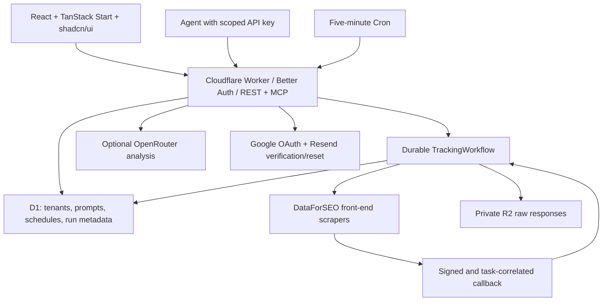

# Cloudflare-led architecture

## Data model

- Better Auth owns users, accounts, sessions, verifications, auth rate limits. Drizzle adapter supplies its D1 access.
- Organizations own memberships, encrypted provider settings, API keys, invitations, audit events and run-count settings.
- Brands belong to an organization, not a user: own, client or competitor, with domain and explicit aliases.
- Workspaces belong to an organization and optionally reference a primary brand. One workspace per agency client groups prompts and history while sharing the agency's team, billing, credentials, and limits. Use a separate organization for a client with separate access, credentials, or billing. Default workspace supports sandbox research.
- Prompts belong to one workspace and can reference a brand tracked there. Every new run snapshots only that workspace's assigned brands, execution settings, and prompt text. An empty brand set still supports collection and source research. Past snapshots retain the brands assigned at collection time. All workspaces is an organization-wide view, and Default workspace is a regular workspace.
- Composite organization/resource foreign keys prevent cross-tenant workspace/brand references. API membership checks are enforced independently.
- Schedules attach to individual prompts. Each scheduled local time has its own date-and-time slot for duplicate dispatcher invocations and DST fall-back. Daily, weekly, M/W/F, custom weekdays; editable IANA timezone/time; same-day catch-up only.
- D1 migrations are explicit versioned SQL. Drizzle is presently used for authentication, not a claimed automatic PostgreSQL migration layer.

## Execution and reliability

Create a durable run with an organization-scoped idempotency key and atomic monthly run-count admission. Persist before external work. The Workflow receives only the run ID, claims that run with an atomic state update, and starts collection within the organization’s provider submission rate. Accepted tasks can remain in flight while more runs start.

Submission is never automatically retried after an ambiguous network outcome. It becomes `uncertain`, requiring inspection in DataForSEO. This avoids silently charging twice. Unstarted queued jobs are dispatched round-robin by tenant using SQL window order.

Standard/priority tasks persist their DataForSEO task ID. A signed pingback must match that ID before signalling the Workflow. Five-minute event timeouts poll the **same** task and recover missing callbacks. Cron additionally reconciles submitted/stale work. Live mode skips the external queue/callback but still executes in a durable Workflow.

Raw provider JSON goes to private R2 at `org/run.json`. Authenticated download uses the run's stored object key after tenant checks. Credentials are never included in raw response storage or browser responses.

## Research semantics

ChatGPT/Gemini use LLM Scraper, not LLM Responses. Google uses Organic Advanced with asynchronous AI Overview loading and `resolve_poisoned_results=true` by default. Both Google options may incur additional provider charges. Organic rankings are kept separate from AI citations. No AI Overview is a valid Google collection with no eligible AI answer, not a zero-valued answer sample.

Citations are explicit source/reference/link objects with HTTP(S) URLs. Grounding/fan-out queries and detected brands are retained when supplied. Missing provider metadata is not inferred. Metrics use successful, nonempty AI answers only; brand rates additionally require that brand in the immutable run snapshot. Whole-name/alias matching is case-insensitive, Unicode-boundary-aware; domain matching includes canonical subdomains.

Charts/research aggregate the **loaded** paginated run history with visible range/workspace/engine filters. This beta does not claim a precomputed unbounded warehouse query. CSV exports the latest 1,000 organization runs.

## Security and current limits

- AES-256-GCM uses a 32-byte Worker secret and organization ID as authenticated additional data; ciphertext format/key version is explicit.
- API/invitation tokens have 256 bits of randomness; only SHA-256 hashes are stored. Keys expire, are scoped read/write/run, and remain subject to the creator's current membership. API keys cannot manage credentials, members, or issue other keys.
- Session writes require same-origin browser requests; agents use Bearer keys. Google and email authentication use Better Auth; email verification is mandatory.
- Application API rate limiting uses durable D1 minute buckets; Better Auth's own database rate limits protect authentication.
- Audit events cover credential/settings/key/team mutations without values. No plaintext secrets are logged.
- Each organization's plan sets its monthly run allowance. DataForSEO execution and optional OpenRouter analysis incur separate provider costs.
- Scheduled dispatch reads indexed due slots in pages of up to 100, rotates across organizations, and stops after 16 pages or its time budget. Cron can launch up to 16 batches of 100 Cloudflare Workflows per sweep. Recovery polls up to 12 due accepted tasks per sweep, four at a time, using their existing provider task IDs. API lists are bounded. Hosted throughput requires staging measurement.
- Rotation migration/restore, billing lifecycle, production Docker packaging, alerting and representative load testing remain launch gates. Cloudflare D1/R2/Workflow adapters are currently direct; portable infrastructure adapters are future work.

## Self-hosting and configuration requirement

Self-hosting is a product requirement, not just an optional idea. The current supported infrastructure is Cloudflare; deployment to an operator-owned Cloudflare account must use that operator's own D1/R2/Workflow resources and credentials. Portable non-Cloudflare hosting/Docker still needs adapters and packaging; do not claim it already works.

For the pending PostHog integration, use optional per-deployment runtime configuration (`POSTHOG_PROJECT_KEY` and `POSTHOG_HOST` proposed names), disabled when absent. The browser may receive only the public project ingestion key and validated ingestion host through a small public runtime-config endpoint. Never expose personal/admin API keys or provider/auth/encryption secrets. Do not hardcode the hosted operator's PostHog project, enable telemetry for self-hosters by default, or require source edits/rebuilding just to switch analytics projects. Runtime configuration should map to Cloudflare Variables/Secrets today and environment/config adapters on other future hosts. Vite-prefixed browser variables are build-time configuration and are not interchangeable with Worker runtime variables. This is the agreed configuration design, not an implemented PostHog integration.

Local development now uses isolated `wrangler.local.jsonc`; `setup:local` generates stable local secrets and applies local migrations. Self-host builds use explicit `TRACKRANK_CONFIG` through the checked `*:selfhost` helpers and owner-supplied `wrangler.selfhost.json`. Public legal operator/contact data is loaded from a whitelisted server function using `PUBLIC_OPERATOR_NAME` / `PUBLIC_SUPPORT_EMAIL`; it never returns the full environment.

## Bulk-first collection and scheduling

Bulk is the primary interaction; one item is a batch of one. Prompt paste accepts
lines or comma-delimited input, including quoted commas. Auto prefers lines, so
commas within a multi-line prompt list are preserved. Each engine selection saves
an independent prompt variant; saving does not submit a provider job. Batches are
validated before transactional writes, with tenant-scoped source IDs and a maximum
of 500 prompt/engine combinations. Exact existing matches are reused.

Bulk run requests carry a stable batch key and requested-payload hash. Replays
reuse run identities; changed-payload key reuse is refused. Each sample has its own
run/config/snapshot; retries do not resubmit uncertain/accepted external jobs.
Manual collections use the organization's remaining monthly run allowance. Large selections span multiple requests.
Admission uses bounded D1 batches with per-insert quota conditions to handle races. Any
changed allowance is reported explicitly; returned rows are the only queued work.
The HTTP request launches admitted workflows in groups of at most 100, and Cron
can pick up any runs that are still queued and do not have a workflow in progress.
Provider credentials and canonical engine/location/language settings are checked
before admission. Starter allows 10 DataForSEO Standard/Priority POSTs and 10
Live POSTs per UTC minute. Standard/Priority POSTs batch up to 100 runs for
the same organization and engine. Each Live POST submits one run.

Scheduled batches store one schedule per selected engine-prompt, a shared batch ID,
up to 8 local times per scheduled day, and 1–10 independent samples per time slot.
Stable local-date/time/sample keys make cron reruns idempotent. A single-prompt
schedule uses the same API as a batch. Delayed dispatch catches up each eligible slot
on the same local day. A repeated DST hour runs once, and nonexistent local times
are skipped. Slots without access, credentials, or quota are skipped. Timing edits take effect for future slots and do not
retroactively charge for past times. Dispatch admission is bounded and round-robin
by organization. Saving creates a paused batch; enabling it is a distinct user action.

Google scraper payloads retain depth=10, async AI Overview loading and the optional
poisoned-SERP fixer (on by default). Organic results (rank/title/URL/domain/snippet)
remain separate from AI answer/citation evidence; absent AI Overviews are not
fabricated and organic-only results do not count as AI brand mentions.

## Commercial ownership

`billing_accounts` has a stable primary ID and a unique organization foreign key. Its unique nullable `customer_id` binds to Stripe, and its unique nullable `subscription_id` permits one current subscription. Organization insertion creates the account transactionally. The customer is created lazily with account-scoped idempotency, never tied to the employee who clicks Checkout. Checkout locking is account-scoped. Signed webhooks map Customer IDs to accounts and their exact organization plan; metadata is not ownership proof. `billing_account_admins` delegates financial access to current organization members through composite foreign keys. It is independent of content roles and commercial limits. Multiple organizations cannot currently share an account; consolidated enterprise billing requires a deliberate quota/access design rather than reusing customer IDs.
