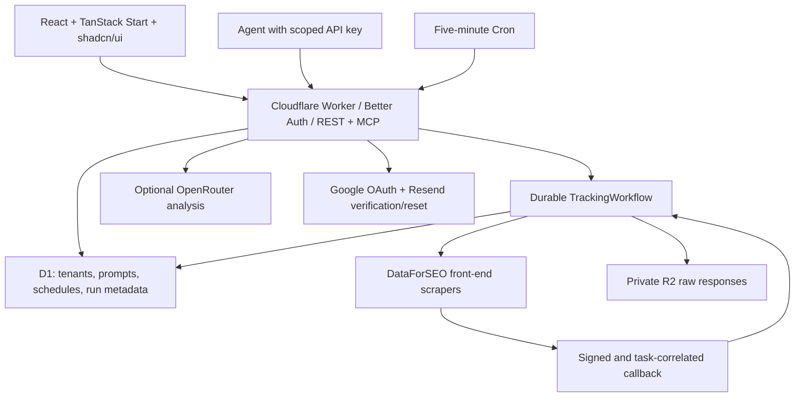

# Cloudflare-led architecture

## Data model

- Better Auth owns users, accounts, sessions, verifications, auth rate limits. Drizzle adapter supplies its D1 access.
- Organizations own memberships, encrypted provider settings, API keys, invitations, audit events and run-count settings.
- Brands belong to an organization, not a user: own, client or competitor, with domain and explicit aliases.
- Workspaces belong to an organization and optionally reference a primary brand. Default workspace supports sandbox research.
- Prompts belong to a workspace and optionally reference a brand. Workspace brand sets define context-specific own/client/competitor relationships; an empty set is an organization-wide research sandbox. Every run snapshots **the workspace brand set (or all organization brands for a sandbox)**, execution settings, prompt text, and parser outputs; historical snapshots do not change when a brand is added later.
- Composite organization/resource foreign keys prevent cross-tenant workspace/brand references. API membership checks are enforced independently.
- Schedules attach to individual prompts. One date-local slot per schedule makes duplicate dispatcher invocations and DST fall-back safe. Daily, weekly, M/W/F, custom weekdays; editable IANA timezone/time; same-day catch-up only.
- D1 migrations are explicit versioned SQL. Drizzle is presently used for authentication, not a claimed automatic PostgreSQL migration layer.

## Execution and reliability

Create a durable run with an organization-scoped idempotency key and atomic daily run-count admission. Persist before external work. The Workflow receives only the run ID and acquires a SQL admission guard allowing at most three submitting/submitted provider tasks per organization.

Submission is never automatically retried after an ambiguous network outcome. It becomes `uncertain`, requiring inspection in DataForSEO. This avoids silently charging twice. Unstarted queued jobs are dispatched round-robin by tenant using SQL window order.

Standard/priority tasks persist their DataForSEO task ID. A signed pingback must match that ID before signalling the Workflow. Five-minute event timeouts poll the **same** task and recover missing callbacks. Cron additionally reconciles submitted/stale work. Live mode skips the external queue/callback but still executes in a durable Workflow.

Raw provider JSON goes to private R2 at `org/run.json`. Authenticated download uses the run's stored object key after tenant checks. Credentials are never included in raw response storage or browser responses.

## Research semantics

ChatGPT/Gemini use LLM Scraper, not LLM Responses. Google uses Organic Advanced with asynchronous AI Overview loading and `resolve_poisoned_results=true` by default. Both Google options may incur additional provider charges. Organic rankings are kept separate from AI citations. No AI Overview is a valid Google collection with no eligible AI answer, not a zero-valued answer sample.

Citations are explicit source/reference/link objects with HTTP(S) URLs. Grounding/fan-out queries and detected brands are retained when supplied. Missing provider metadata is not inferred. Metrics use successful, nonempty AI answers only; brand rates additionally require that brand in the immutable run snapshot. Whole-name/alias matching is case-insensitive, Unicode-boundary-aware; domain matching includes canonical subdomains.

Charts/research aggregate the **loaded** paginated run history with visible range/workspace/engine filters. This beta does not claim a precomputed unbounded warehouse query. CSV exports the latest 1,000 organization runs.

## Security and current limits

- AES-256-GCM uses a 32-byte Worker secret and organization ID as authenticated additional data; ciphertext format/key version is explicit.
- API/invitation tokens have 256 bits of randomness; only SHA-256 hashes are stored. Keys expire, are scoped read/write/run, and remain subject to the creator's current membership. API keys cannot manage credentials, members, or issue other keys.
- Session writes require same-origin browser requests; agents use Bearer keys. Google and email authentication use Better Auth; email verification is mandatory.
- Application API rate limiting uses durable D1 minute buckets; Better Auth's own database rate limits protect authentication.
- Audit events cover credential/settings/key/team mutations without values. No plaintext secrets are logged.
- Beta run-count limit defaults to 20/day/org, configurable 1–100. This is NOT a monetary spending ceiling. OpenRouter analysis is explicit and separately billed.
- Scheduler scans at most 1,000 schedule candidates per dispatch, starts up to eight new workflows, and performs bounded reconciliation. API lists are bounded; production capacity must be measured before promising high-volume/unlimited use.
- Rotation migration/restore, billing lifecycle, production Docker packaging, alerting and representative load testing remain launch gates. Cloudflare D1/R2/Workflow adapters are currently direct; portable infrastructure adapters are future work.
